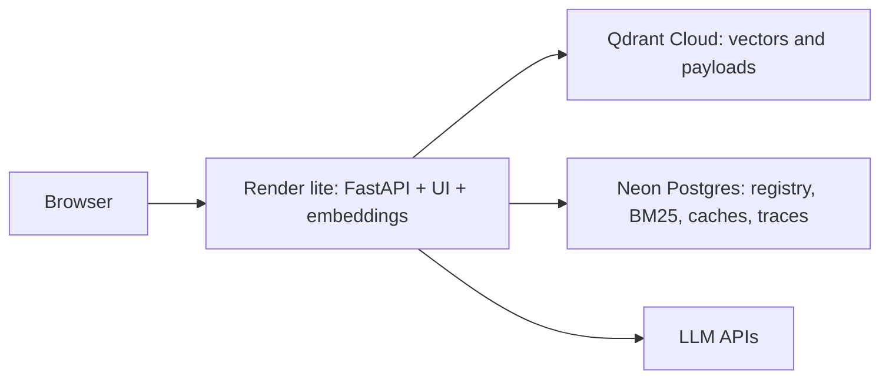

# Deployment



## Hosting

The demo uses Render free with the lite profile: 512 MB RAM, 0.1 vCPU, no card.
See [Render plans](https://render.com/docs/compute-plans) and
[free service limits](https://render.com/docs/free). It sleeps after 15 minutes idle;
a new request triggers a cold start, followed by lazy model loading. Expect high
embedding and investigation latency on 0.1 vCPU.

[HF Docker Spaces](https://huggingface.co/docs/hub/spaces-overview) require PRO for
personal accounts. [Cloud Run requires a billing account](https://docs.cloud.google.com/billing/docs),
with a $30 prepayment for some cards during account setup. Full remains the default for hosts
with at least 2 GB: local Docker, a paid Space, or Cloud Run.

| Setting | Full | Lite |
| --- | --- | --- |
| RERANK_ENABLED | true | false |
| NLI_ENABLED | true | false |
| WARMUP | production background warm-up | false |
| LSH_REBUILD_ON_STARTUP | true | false |
| EMBEDDING_BATCH_SIZE | 64 | 8 |
| AGENT_MAX_STEPS | 5 | 3 |
| Verification | NLI plus grounding | grounding |

Set DEPLOYMENT_PROFILE=lite. Explicit env values override each profile default.
Unset profile-specific variables to use defaults; copying full values from
.env.example overrides lite defaults. Grounding requires all claim entities in
cited text and content overlap of 0.5 with entities, otherwise 0.75. Compound
splitting and abstention remain, without NLI contradiction checking.

HotpotQA n=1,018: hybrid without rerank has Recall@10 0.862 vs 0.874 and MRR@10
0.881 vs 0.933. These retrieval results do not measure the end-to-end cost of
removing NLI or reducing agent steps.

Skipping LSH rebuild avoids about 67k signatures (~150 MB, ~45 seconds). The empty
index only covers documents ingested by this process. Registry hashes still catch
exact duplicates; near-duplicates against the seed corpus are skipped.

## First deployment

1. Create Qdrant Cloud, Neon and generation-provider accounts.
2. Index locally using `uv run python -m scripts.index_corpus --help`. Use an isolated
   database and collection while another indexing job runs. Finish indexing and stop
   source mutations before migration; copying an actively changing index is not a snapshot.
3. Create a Qdrant cluster and API key. Create a Neon database and copy its SSL connection
   string, using `postgresql+psycopg://` as its SQLAlchemy scheme and `sslmode=require`.
   Put target `QDRANT_URL`, `QDRANT_API_KEY`, and `DATABASE_URL` in the gitignored `.env`.
4. Run from the repository root (PowerShell):

   ```powershell
   uv run python -m scripts.migrate_to_cloud --source-qdrant http://localhost:6333 --source-collection documents --source-db sqlite:///./data/registry_documents.db --batch 256
   ```

   Targets default to `.env` settings; CLI overrides include `--target-qdrant`,
   `--target-api-key`, `--target-collection`, and `--target-db`. Prefer environment
   secrets to command-line values, which may enter shell history. Source SQLite opens
   read-only. Only five index tables are copied; request caches and logs stay local.
   Vector batches retry and checkpoint at `data/migrate_checkpoint.json` after confirmed
   upserts. Rerun the same command after interruption. SQL upserts are transactional
   and repeatable. Counts must match; stale target rows require `--replace`, which
   deletes target data before copying. It never deletes source data. Use a dedicated
   target and checkpoint for each migration. Verify source document/chunk counts first.
5. Create a Render Blueprint from render.yaml. It selects the free plan,
   Dockerfile.lite, and /health. Enter GROQ_API_KEY, GEMINI_API_KEY, QDRANT_URL,
   QDRANT_API_KEY, DATABASE_URL and a strong ADMIN_TOKEN in the dashboard.
   The blueprint sets DEPLOYMENT_PROFILE=lite, APP_ENV=prod and QDRANT_COLLECTION=documents.
6. Verify /health, /ready, /api/stats, search and an investigation with citations.
   /ready touches both remote databases. Compare migrated counts.

Dockerfile.lite bakes only embeddings and listens on PORT (default 7860).
The main Dockerfile builds full by default and accepts --build-arg PROFILE=lite;
set DEPLOYMENT_PROFILE=lite at runtime for that build.

HF PRO users can still use `uv run python -m scripts.deploy_space username/space --dry-run`
and then omit --dry-run to deploy full. Set HF_TOKEN locally; it stays on the deployment
machine. The existing Space workflow is an optional HF deployment path.

Run `uv run python -m scripts.measure_memory --profile lite` (or full) locally with
optional psutil installed. It builds isolated in-memory stores, warms selected models
and samples RSS. This is a startup/warm-up peak, not a production request bound.
No measured 512 MB guarantee is claimed.

## Optional HF PRO secrets and automation

`.env` is gitignored and must never be uploaded. Provider keys, database URL,
Qdrant endpoint/key and admin token become HF Space secrets. `HF_TOKEN` remains on
 the deployment machine or in GitHub secrets, never inside the Space. Ordinary model
IDs and collection settings become Space variables. Public Space source is visible.

For workflows, set repository variable `SPACE_ID=username/space` and `SPACE_URL` to
its direct `https://username-space.hf.space` URL. Add repository secrets `HF_TOKEN`,
`GROQ_API_KEY`, `GEMINI_API_KEY`, `OPENROUTER_API_KEY`, `QDRANT_URL`, `QDRANT_API_KEY`,
`DATABASE_URL`, and `ADMIN_TOKEN`. Manual dispatch or a `v*` tag runs deployment.
Configure model variables in the Space if defaults no longer work; local deployment
also propagates configured model IDs. Remove unused secrets directly in Space settings:
redeployment updates supplied secrets but does not delete existing ones.

## Persistence and availability

The container is stateless. Qdrant holds vectors and payloads; Postgres holds registry,
versions, BM25 statistics, index version, request caches and traces. Restarts discard
container disk; the image retains its model cache. Never use SQLite or in-memory
Qdrant for a production Space. Model IDs must match the image's downloaded models;
changing models requires rebuilding and, for embeddings, rebuilding the index.

Render disk is lost on sleep, restart or redeploy. Keep production stores remote.
HF PRO is a paid alternative; the full profile needs at least 2 GB and actual RSS
should be measured with concurrency headroom.

## Operations

Run the app with a single worker process. The LSH index, BM25 statistics snapshot, and rate limiter are process-local; multiple workers cannot keep them consistent. The Dockerfile runs one worker. Keep WEB_CONCURRENCY and UVICORN_WORKERS set to 1.


Redeploy Render from its dashboard or connected repository. Rotate keys at their provider
and update dashboard secrets, then verify readiness. For HF, rerun the script or workflow.
Do not log connection strings or key values. Change `ADMIN_TOKEN` at the same time
in authorized clients. Review traces and `/metrics` for latency and provider failures.

Re-index into a new local collection/database, stop index writes, migrate into a new
remote collection/database, then switch Space secrets/variables and redeploy. Retain
old stores until validation passes. Restore from a stopped local index using a fresh
checkpoint and target; use `--replace` only when intentionally replacing that target.
Caches and traces are recreated empty after migration; back them up separately if
needed. A checkpoint is progress metadata, not a backup. Keep source SQL and Qdrant
snapshots together so registry, sparse statistics and vectors describe the same index.
